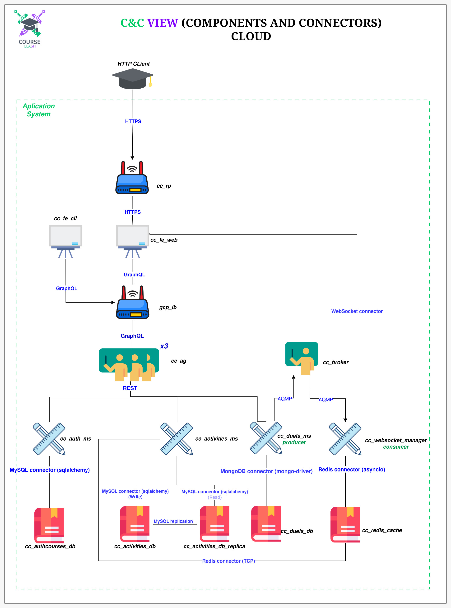

# CourseClash - Gamified Learning Platform

**CourseClash** is an educational project designed to learn and practice system architecture concepts. It's a gamified learning platform that motivates students through interactive elements such as achievements, rankings, and profile personalization.

## About This Project

This project serves as a comprehensive learning exercise in distributed systems architecture, microservices design, and cloud-native application development. It demonstrates various architectural patterns, communication protocols, and infrastructure components commonly used in modern software systems.

## System Architecture

The CourseClash system implements a multi-tier, microservices-based architecture. The following diagram illustrates the complete system architecture:



### Architecture Overview

The system follows a **Components and Connectors (C&C) View** architecture pattern, organized into several layers:

#### 1. **Client Access Layer**

- **HTTP Client**: External clients access the system via HTTPS
- **Reverse Proxy (`cc_rp`)**: Routes incoming HTTPS requests to front-end applications
- **Front-End Applications**:
  - `cc_fe_cli`: Command-line interface front-end
  - `cc_fe_web`: Web-based front-end application

#### 2. **API Gateway & Load Balancing Layer**

- **GCP Load Balancer (`gcp_lb`)**: Distributes GraphQL requests across multiple API Gateway instances
- **API Gateway (`cc_ag`)**: Single entry point for all client requests (scaled x3 for high availability)
  - Handles authentication and authorization
  - Routes requests to appropriate microservices
  - Uses GraphQL for flexible data querying

#### 3. **Microservices Layer**

The system consists of several specialized microservices communicating via REST:

- **`cc_auth_ms` (Authentication Microservice)**:

  - User registration, login, and session management
  - Profile management
  - Implemented in Python with FastAPI

- **`cc_activities_ms` (Activities Microservice)**:

  - Manages activities, tasks, quizzes, and grades
  - Handles read/write operations with database replication
  - Implemented in Python with FastAPI

- **`cc_duels_ms` (Duels Microservice)**:

  - Real-time duel logic and rankings
  - Acts as a message producer for async events
  - Implemented in Go for high concurrency performance

- **`cc_websocket_manager` (WebSocket Manager)**:
  - Manages real-time WebSocket connections
  - Acts as a message consumer for real-time updates
  - Implemented in Python with FastAPI

#### 4. **Message Broker Layer**

- **`cc_broker` (Message Broker)**: RabbitMQ-based message broker
  - Handles asynchronous communication between services
  - Uses AMQP (Advanced Message Queuing Protocol)
  - Enables event-driven architecture patterns
  - Connects `cc_duels_ms` (producer) with `cc_websocket_manager` (consumer)

#### 5. **Data Layer**

The system uses multiple databases optimized for different use cases:

- **`cc_authcourses_db`**: MySQL database

  - Stores user authentication data, profiles, and course information
  - Connected via SQLAlchemy ORM

- **`cc_activities_db`**: MySQL primary database

  - Stores activities, tasks, quizzes, and grades
  - Handles write operations
  - Replicates to read replica for scalability

- **`cc_activities_db_replica`**: MySQL read replica

  - Handles read operations to reduce primary database load
  - Synchronized via MySQL replication
  - Connects to Redis cache for performance optimization

- **`cc_duels_db`**: MongoDB database

  - Stores duel data, rankings, and real-time statistics
  - Optimized for flexible schema and high write throughput
  - Connected via MongoDB driver

- **`cc_redis_cache`**: Redis cache
  - Provides high-speed caching layer
  - Used by WebSocket manager for session management
  - Connected via asyncio Redis connector

### Communication Protocols

The system uses various protocols optimized for different communication patterns:

- **HTTPS**: Secure HTTP for client-to-server communication
- **GraphQL**: Flexible API querying between front-end and API Gateway
- **REST**: Standard HTTP-based communication between API Gateway and microservices
- **AMQP**: Asynchronous message queuing for event-driven communication
- **WebSocket**: Real-time bidirectional communication for live updates
- **MySQL Replication**: Database synchronization for read scalability
- **TCP**: Direct database-to-cache connections

## Key Features

### Core Functionality

- User authentication and profile management
- Complete activity management (tasks, quizzes)
- Automated activity grading
- Real-time communication via WebSockets
- Asynchronous messaging system

### Gamification Features

- Achievement and badge system
- Dynamic rankings and leaderboards
- User profile personalization
- Ranking and classification system
- Real-time competitive duels
- Live events and notifications

## Technology Stack

### Backend Services

- **Python 3.8+**: FastAPI for RESTful microservices
- **Go 1.16+**: High-performance duel service
- **RabbitMQ**: Message broker for async communication
- **GraphQL**: Flexible API querying

### Databases

- **MySQL**: Relational databases for structured data (auth, activities)
- **MongoDB**: Document database for flexible duel data
- **Redis**: In-memory cache for performance

### Frontend

- **Next.js**: React-based web framework
- **TypeScript**: Type-safe frontend development
- **GraphQL Client**: Apollo Client for data fetching

### Infrastructure

- **Docker & Docker Compose**: Containerization and orchestration
- **GCP Load Balancer**: Cloud-based load balancing
- **Reverse Proxy**: Nginx-based request routing

## Development Setup

### Prerequisites

- Python 3.8+
- Go 1.16+
- Node.js 14+
- Docker and Docker Compose
- MySQL
- MongoDB

### Installation

1. Clone the repository:

   ```bash
   git clone https://github.com/tu-usuario/CourseClash.git
   cd CourseClash
   ```

2. Start all services with Docker Compose:

   ```bash
   docker-compose up -d
   ```

3. Access the application:
   - Web Frontend: http://localhost:3000
   - API Gateway: http://localhost:8000

## Project Structure

```
CourseClash/
├── api_gateway/              # API Gateway service (GraphQL)
├── auth_user_service/        # Authentication microservice
├── activities_service/       # Activities microservice
├── duel_service/             # Duels microservice (Go)
├── websocket_manager/        # WebSocket manager service
├── broker_service/           # RabbitMQ message broker
├── frontend_web/             # Web frontend (Next.js)
├── frontend_cli/             # CLI frontend
├── reverse_proxy_service/    # Nginx reverse proxy
├── load_balancer_ag/         # Load balancer configuration
├── mongo_service/            # MongoDB configuration
├── mysql_auth/               # MySQL scripts for authentication
├── mysql_activities/         # MySQL scripts for activities
├── mysql_courses/            # MySQL scripts for courses
├── docs/                     # Documentation
│   └── system_architecture.jpeg
└── docker-compose.yml        # Docker Compose configuration
```

## Learning Objectives

This project demonstrates:

- **Microservices Architecture**: Service decomposition and independence
- **API Gateway Pattern**: Centralized request routing and authentication
- **Message Queue Patterns**: Asynchronous event-driven communication
- **Database Patterns**: Multi-database architecture, read replicas, caching
- **Real-time Communication**: WebSocket implementation for live updates
- **Load Balancing**: Horizontal scaling and high availability
- **Cloud Deployment**: GCP infrastructure integration
- **Containerization**: Docker-based deployment and orchestration

## Contributing

This is an educational project. Contributions, suggestions, and improvements are welcome!

## License

MIT License

---

**Note**: This project is designed for learning system architecture concepts. It demonstrates various architectural patterns and technologies commonly used in production systems.
